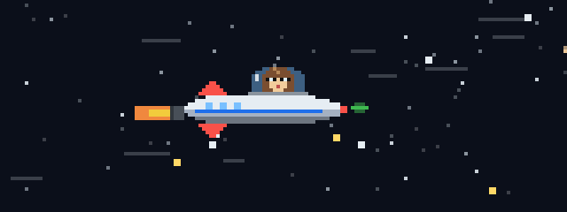

## Sobre mí

- DevOps y desarrollo web.
- Automatizo despliegues, infraestructura y todo lo que se pueda repetir dos veces.
- Aprendiendo en público: aquí voy dejando mis proyectos y notas.

## Stack

## Estadísticas

## Contacto

